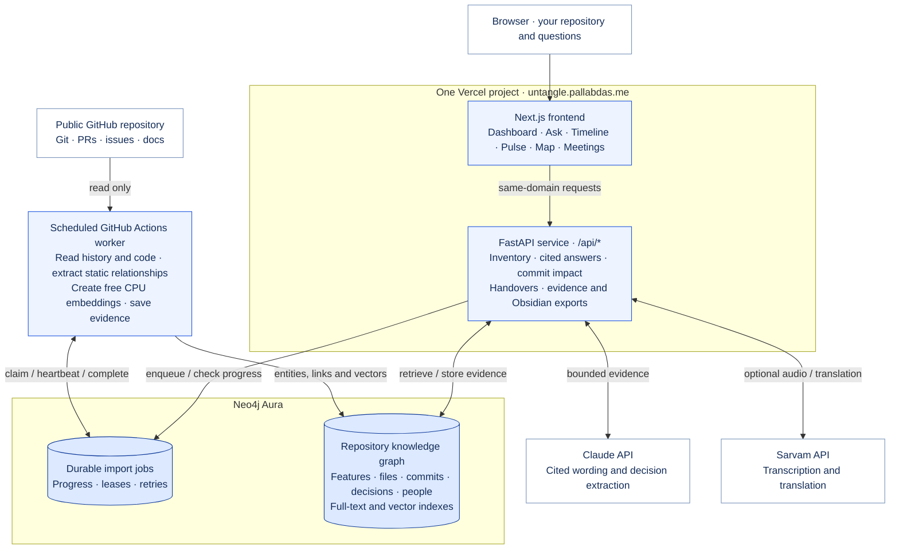

<div align="center">

# 🧶 Untangle

### Ask why the code is like this.

**Decision history · evidence chains · handover context**

### [untangle.pallabdas.me](https://untangle.pallabdas.me)

[](https://github.com/PDGamerSG/Untangle/actions/workflows/ci.yml)
[](https://www.python.org/)
[](https://neo4j.com/)
[](LICENSE)

</div>

Untangle turns repository history and knowledge-transfer recordings into a searchable decision graph. Ask about a
configuration value, dependency, file, or module and it traces the decision, the discussion, the person, and the date.
When the graph cannot support an answer, Untangle says so instead of guessing.

## 💡 Why you'll like it

| | |
|---|---|
| 🧭 **Follow the why** | Connect a current value to the commit, pull request, issue, document, or handover call that explains it. |
| ⏳ **See what changed** | Keep superseded decisions visible and ask what was in force on a past date. |
| 🧾 **Read the receipts** | Every answer exposes citations, the graph route, and the person with the most relevant history. |
| 🗣️ **Keep handovers searchable** | Link Hinglish transcripts to files, keys, dependencies, and decisions without replacing code history. |
| 🛑 **Refuse safely** | Unsupported questions get a clear refusal and nearby context instead of an invented explanation. |
| 🔎 **Compare retrieval** | Put graph reasoning beside vector-only search over the same evidence. |
| 🧰 **Investigate a snapshot** | Search Timeline by file, value, reason or person; inspect each decision's sources and ask about the selected date. |
| 📋 **Take evidence into a review** | Filter Pulse by risk category or criticality and download the visible decisions or risks as a source-linked Markdown brief. |
| 🕸️ **Map features to commits** | Explore feature entry points, shared code and Git parents. Select a commit to trace potential impact and export linked notes for Obsidian. |

## 🚀 Three steps

On the live app, open **Repositories**, paste a public GitHub URL,
and import it. Progress is saved while the background worker indexes the repository. Open its workspace when ready
to use the tools below with your own repository. See [repository onboarding](docs/REPOSITORY_IMPORTS.md) for coverage,
limits and worker configuration.

1. **Ingest the history.** Load Git, GitHub, documents, configuration changes, and optional handover transcripts.
2. **Ask a concrete question.** Name a value, dependency, file, module, or date in the CLI or web app.
3. **Follow the evidence.** Read the decision chain, citations, supersession state, and person to ask.

## 📥 Download and run

You can also self-host Untangle. [Download the source ZIP](https://github.com/PDGamerSG/Untangle/archive/refs/heads/main.zip),
or clone it with Git. Start Neo4j, then run the Python and web clients locally.

```bash
# 1. Get the source
git clone https://github.com/PDGamerSG/Untangle.git
cd Untangle

# 2. Prepare the backend
cp .env.example .env
# Set NEO4J_PASSWORD and ANTHROPIC_API_KEY. Add GITHUB_TOKEN for a higher GitHub API limit.
docker compose up -d --wait neo4j
uv sync --locked --all-extras

# 3. Create the schema and ingest a repository
uv run untangle schema
uv run untangle ingest knadh/listmonk
uv run untangle kt ingest --repo knadh/listmonk --transcript data/kt/listmonk-kt-sample.json
uv run untangle serve
```

In a second terminal, start the web client at `http://localhost:3000`:

```bash
cd Untangle/web
pnpm install --frozen-lockfile
pnpm dev
```

For a tour without a running API or database, start the web client in sample mode instead:

```bash
cd Untangle/web
pnpm install --frozen-lockfile
NEXT_PUBLIC_UNTANGLE_SAMPLE=1 pnpm dev
```

Sample mode displays a banner and replays fixtures; it never silently replaces a failed live API request.

The repository also includes a separate static landing page. It does not call the API or Neo4j and can be run independently:

```bash
cd Untangle/landing
pnpm install --frozen-lockfile
pnpm dev                                      # http://localhost:5180
```

Build it with `pnpm build`; the generated `dist/` directory is deployable to any static host.

| Requirement | Details |
|---|---|
| Operating system | macOS, Linux, or Windows with Docker and a shell; CI runs on Ubuntu. |
| Runtime | Python 3.12–3.13, uv, Node 20.9+ (CI uses 22), pnpm 10, and Neo4j (CI uses 2025.09). |
| Services | Claude API key for model-generated answers; Sarvam key for audio transcription; optional GitHub token for large ingests. The local embedding model is free and needs no API key. |
| Not supported | The project does not record audio for you, infer undocumented intent, or guarantee that synthetic sample reasons describe the public fixture repository. |

## 🧪 What it does

| Stage | What happens |
|---|---|
| Ingest | Read commits, renames, config and dependency history, pull requests, reviews, issues, documents, and symbols. |
| Enrich | Add optional GitHub discussions, embeddings, and Sarvam-transcribed handover utterances. |
| Record | Store entities, evidence, people, meetings, and bi-temporal decisions in Neo4j. |
| Answer | Resolve the question, select active evidence, validate citations, and report supersession or refusal. |
| Explain | Show the same answer through the CLI, FastAPI, Next.js UI, and graph-vs-vector comparison. |

## ⚙️ Architecture



Repository imports run in the background and persist their progress in Neo4j, so closing the browser does not
cancel them. Hosted imports use deterministic extraction and free embeddings; paid answer generation runs when
you ask a question. Imported code is read as data and never executed. Commit impact shows potential downstream
effects from indexed static imports; it does not execute a revert or prove which tests would fail.

The graph links `Feature → entrypoint File → imported File` and `Commit → changed File`, while decisions connect
to their subjects, evidence and contributors. Later decisions link to earlier ones through `SUPERSEDES`.
See the [graph model](docs/GRAPH_MODEL.md) and [feature-map coverage](docs/FEATURE_MAP.md).

| Component | Purpose | License |
|---|---|---|
| `src/untangle/` | Python CLI, API, graph adapter, ingestion, answers, KT, and evaluation. | MIT |
| `cypher/` | Numbered Neo4j statements used by the product. | MIT |
| `web/` | Next.js client with live API and labelled sample mode. | MIT |
| Neo4j | Graph storage, full-text indexes, and the optional vector baseline. | Neo4j Community/Enterprise terms |
| Sarvam AI | Optional speech-to-text and language services for KT recordings. | Sarvam terms |

Backend settings live in `.env`; frontend overrides belong in `web/.env.local`. In production, Vercel routes `/api`
to the Python service in the same project. Locally, Next.js proxies `/api` to `UNTANGLE_API_URL` (default
`http://127.0.0.1:8090`). Rebuild after changing the local proxy URL or any
`NEXT_PUBLIC_*` setting. `.env.example` selects Claude and the free local `BAAI/bge-small-en-v1.5` embedding model.
For offline fixture tests, explicitly select `LLM_BACKEND=fake` and `EMBED_BACKEND=fake`.

For the single-project Vercel setup, required credentials, and checks on both public domains, see [Deployment](docs/DEPLOYMENT.md).

Decisions are keyed by subject and predicate. A later value links to the older value with `SUPERSEDES` and records
`valid_from` and `valid_to`; it never overwrites the earlier evidence. Handover decisions use separate `kt|…` keys and
are reconciled with the active code decision as `CONFIRMS` or `CONTRADICTS`.

## 🛡️ Responsible use

Get clear consent from every person before recording a handover call. Tell participants that audio may leave the
machine for transcription and that the transcript will be queryable by engineers. Do not record secrets, customer data,
or people who have not agreed. See [data/kt/README.md](data/kt/README.md) for deletion and transcript guidance.

## ⚠️ Known limits

- A full GitHub ingest can be slow and can hit anonymous API limits; use `GITHUB_TOKEN` for larger repositories.
- Neo4j is required for live ingestion and answers. Sample mode is a recorded demonstration, not a live graph.
- Sarvam transcription requires credentials and audio quality affects diarisation and entity matching.
- The deterministic answer path refuses when evidence is missing; optional models cannot add unsupported citations.
- The `knadh/listmonk` repository and the transcript in `data/kt/` are demo fixtures. Fictional speaker explanations are labelled as synthetic.
- Browser coverage is limited to the current Next.js, React, and pnpm toolchain used by CI.
- Timeline filters and exports use the loaded snapshot (up to 100 decisions); Pulse filters and exports use the returned priority queue. These views do not represent a complete repository audit, and risk scores are heuristic signals, not probabilities.
- The feature map uses static imports at the indexed HEAD. Commit impact is an estimate of dependency reachability, not a tested revert. Runtime calls, configuration effects and unsupported languages may introduce missing connections.

## 🛠️ Development

Run the complete local checks from the repository root:

```bash
uv run ruff check src tests
uv run pytest -q
cd web
pnpm install --frozen-lockfile
pnpm lint
pnpm build
pnpm test
pnpm exec playwright install chromium
pnpm test:e2e
```

Python tests that need a reachable Neo4j skip cleanly; the rest use fake model and embedding adapters plus fixture
repositories. GitHub Actions runs the backend checks with a Neo4j service and builds the web client in production mode.

| Folder or file | Contents |
|---|---|
| `src/untangle/` | Backend package and public `untangle` CLI. |
| `cypher/` | Query source of truth, numbered by subsystem. |
| `data/kt/` | Synthetic transcript, consent notes, and recording instructions. |
| `eval/gold/` | Gold questions for the graph and vector baseline. |
| `tests/` | Unit, API, ingestion, graph, and transcript coverage. |
| `web/` | Next.js routes, components, client library, and sample fixtures. |
| `docs/` | Contracts, graph model, evaluation notes, and demo runbook. |
| `scripts/` | Sample export and optional Sarvam audio helpers. |

Useful guides:

- [Graph model](docs/GRAPH_MODEL.md)
- [Contracts](docs/CONTRACTS.md)
- [Evaluation](docs/EVAL.md)
- [Verification record](docs/VERIFICATION.md)
- [Demo runbook](docs/DEMO.md)
- [KT guide](data/kt/README.md)
- [Web guide](web/README.md)
- [Feature map research and indexing](docs/FEATURE_MAP.md)

## 📄 License

[MIT](LICENSE). Third-party component notices are collected in [THIRD_PARTY_NOTICES.md](THIRD_PARTY_NOTICES.md).
